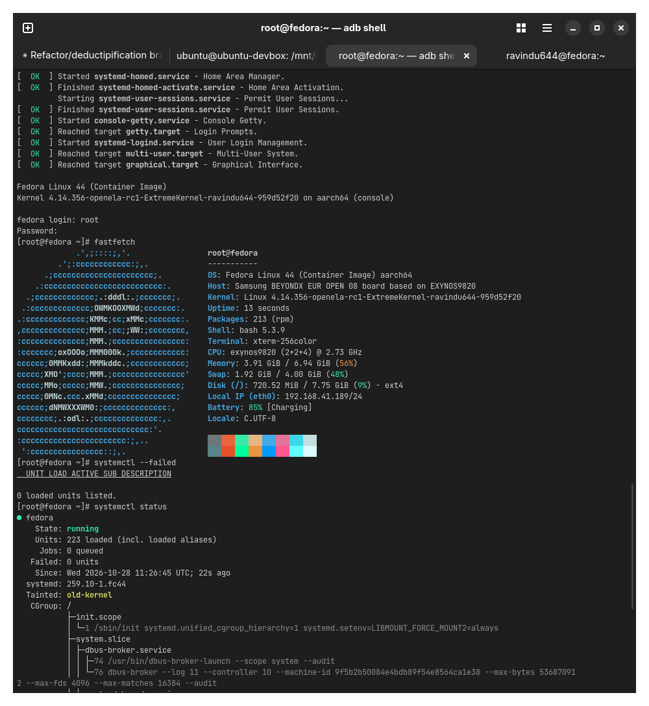
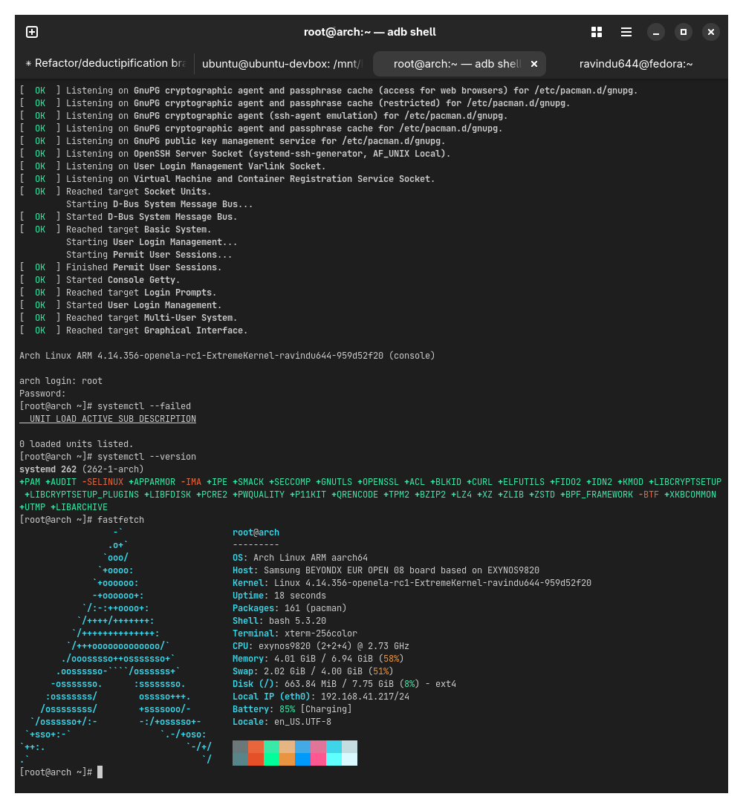

# Modern systemd on old Android kernels

Kernel patches that let a [Droidspaces](https://github.com/ravindu644/Droidspaces-OSS)
container boot systemd 258 through 262 on an Android 4.14 or 4.19 kernel. systemd 258
raised its kernel baseline to 5.4 and 260 to 5.10, and removed the fallbacks that let it run
on anything older. The patches here put back the handful of kernel features it now assumes,
all of them small, all but one mainline cherry-picks.

If you do not want to touch the kernel, pin systemd to 257. It still boots on 4.x.

## Result

Both on a Samsung Galaxy S10 (exynos9820), kernel 4.14.356, with all ten patches applied,
on 2026-10-28:

<table>
  <tr>
    <td width="50%" align="center"><br>Fedora 44, systemd 259.10, zero failed units</td>
    <td width="50%" align="center"><br>Arch Linux ARM, systemd 262, zero failed units</td>
  </tr>
</table>

Both guests reach `graphical.target` with journald, resolved, networkd, logind, userdbd and
dbus-broker up, take a DHCP lease on eth0, resolve DNS, and report `Tainted: old-kernel`
and nothing else.

## What you need

- A 4.14 or 4.19 Android kernel tree you can build. 4.9 and 5.4 have no ready-made series,
  see the [porting page](Documentation/Porting.md).
- Droidspaces newer than 7.1.0. Kernels below 5.2 have no new mount API, which systemd 259
  and later use for service credentials, and the fix for that is in the runtime, not the
  kernel: [commit 3132cc93](https://github.com/ravindu644/Droidspaces-OSS/commit/3132cc9311c5e2582a9c47c40476925b3a9a2c57)
  makes those syscalls return EPERM to a systemd PID 1, which systemd handles. Until the
  next release, use the [CI build](https://t.me/DroidspacesCI/990). `droidspaces check`
  shows a `New mount API` row on builds that have it.

## Which patches

1. Run the probe against your tree. It prints yes or no for every kernel feature systemd
   258 to 262 cares about, and works on a blobless clone.

   ```
   tools/probe-kernel.sh <git dir> <rev>
   ```

2. On 4.14, if it prints `pidfd_open no`, apply
   [`pidfd-backport-4.14/`](pidfd-backport-4.14/README.md) first. That is Google's own
   Android R pidfd backport, twelve patches, for vendor trees frozen before mid 2019.
3. Apply the series for your kernel: [`kernel-4.14-series/`](kernel-4.14-series/README.md)
   or [`kernel-4.19-series/`](kernel-4.19-series/README.md). Ten patches each. Skip any
   patch whose feature the probe already reports as `yes`.
4. Build, boot a systemd guest, and if anything is red, match it against the
   [boot log page](Documentation/Boot-Log.md).

## Where the patches were applied

| Tree | Kernel | Series | What was done |
|---|---|---|---|
| `Kernels-by-ravindu644/samsung_kernel_exynos9820_extremerom` | 4.14.356 | 4.14 | Compiled and booted, Fedora 44 and Arch Linux ARM, screenshots above. |
| `aosp-mirror/kernel_common` `deprecated/android-4.14-stable` | 4.14.336 | 4.14 | Applied, touched objects compiled. |
| `Kernels-by-ravindu644/samsung_kernel_SCV41_droidspaces` | 4.14.190 | 4.14 | Applied unchanged. |
| `Kernels-by-ravindu644/samsung_kernel_exynos9820_stockrom` `pure-stock` | 4.14.113 | pidfd backport, then 4.14 | Applied unchanged. |
| `aosp-mirror/kernel_common` `deprecated/android-4.19-stable` | 4.19.325 | 4.19 | Applied, touched objects compiled with clang 18. |
| `ravindu644/android_kernel_sm_a135f` (Galaxy A13) | 4.19.198 | 4.19 | Applied unchanged. |
| `LineageOS/android_kernel_oneplus_sm8250` | 4.19.324 | 4.19 | Applied unchanged, minus the optional x86 patch. |
| `LineageOS/android_kernel_google_redbull` (Pixel 4a 5G / 5) | 4.19.325 | 4.19 | Applied unchanged, minus the optional x86 patch. |
| `LineageOS/android_kernel_samsung_universal9830` (Galaxy S20) | 4.19.325 | 4.19 | Already had three of the changes; the rest apply, four syscall table lines by hand. |

Only the first tree was booted. The series READMEs have the details per tree.

## Documentation

| Page | What it covers |
|---|---|
| [Requirements](Documentation/Requirements.md) | What each systemd release needs from the kernel, read out of the systemd source. Hard and soft gaps, the new mount API and what Droidspaces does about it, the nexthop problem, what is not the problem. |
| [Porting](Documentation/Porting.md) | What Google's common kernels and several frozen OEM trees already have, what each kernel series from 4.9 to 5.10 needs, where the patches come from, and where the conflicts land when you port them to your own tree. |
| [Boot log](Documentation/Boot-Log.md) | Every log line seen on the way to a clean boot, what it means, and which patch fixes it. |
| [4.14 series](kernel-4.14-series/README.md) | The ten patches for 4.14, where they were applied, and how they deviate from mainline. |
| [4.19 series](kernel-4.19-series/README.md) | The same for 4.19. |
| [pidfd backport](pidfd-backport-4.14/README.md) | Google's twelve pidfd commits for 4.14 trees that never got them. |
